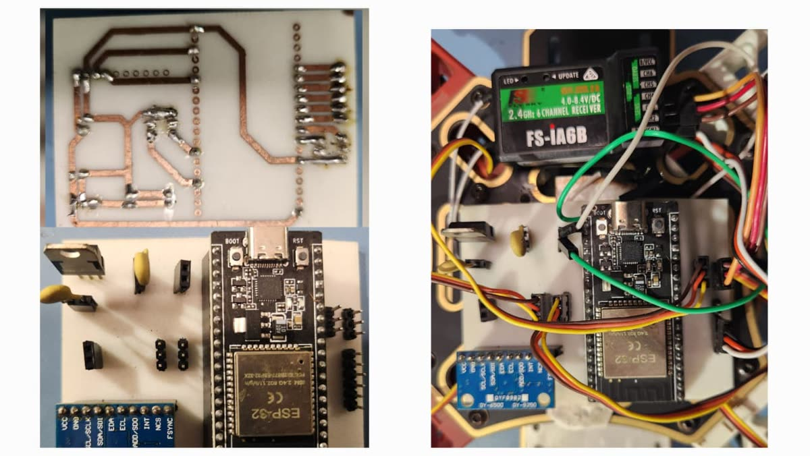
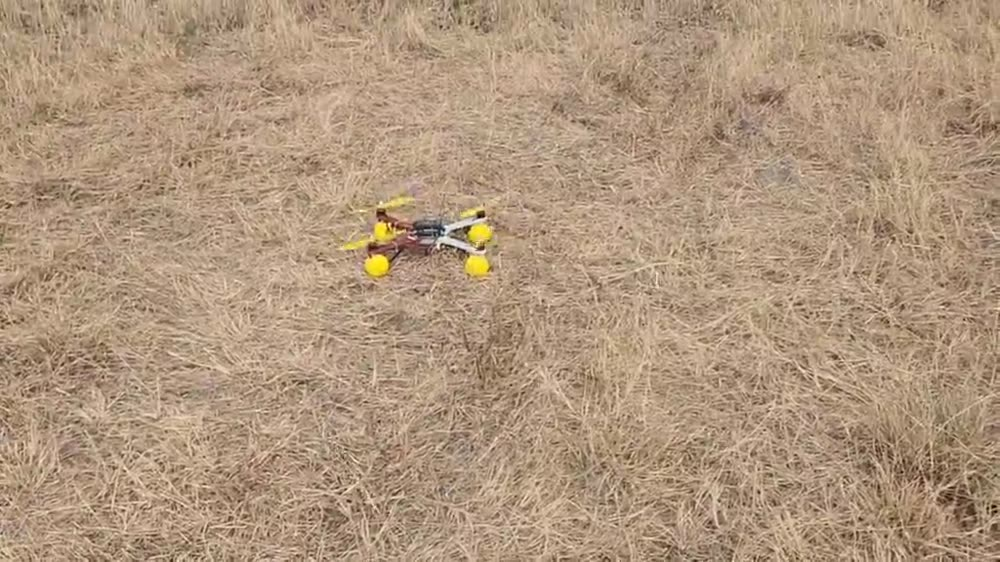

# ESP32 flight controller for GPS-denied flight

A custom flight-controller PCB built around an ESP32, with an extended Kalman filter fusing an
IMU, a magnetometer and an optical-flow sensor, so a drone can hold position with no GPS. It became
the flight stack for a planetary-rotorcraft concept presented at the National Space Science
Symposium (NSSS 2026).

> **Status:** PCB files and firmware are being cleaned up and will be added to this repository.
> Full write-up with video: **[kaunatharva.com/work/esp32-flight-controller](https://kaunatharva.com/work/esp32-flight-controller)**

  
  

## Why build one

On the [IRoC-U 2025 drone](https://github.com/athrvchvn/IRoC-U-2025-Autonomous-Drone), our own
controller and the Pixhawk's internal loops ended up fighting each other. This board is the next
step: a flight stack built from the PCB up, so every loop on it is one we wrote.

## What it is

- **ESP32** flight-controller PCB
- **MPU6050** IMU for attitude
- **Magnetometer** for heading
- **Optical-flow sensor** to measure drift over the ground
- An **extended Kalman filter** fusing the three into one state estimate. Optical flow is what makes
  holding position possible without GPS.

**Result:** a 25-minute stable hover in GPS-denied conditions.

## Planetary rotorcraft (NSSS 2026)

*"Distance-Based Localization and Vision-Guided Landing for Autonomous Planetary Rotorcraft"*
A. Chavan, S. Kharwandikar, H. A. Tanti, A. Datta. Abstract, poster and oral talk at NSSS 2026.

- A UAV for GPS-denied, Mars-like terrain that deploys three base stations as surrogate satellites
  and localizes itself by ranging to them.
- Runs on this ESP32 flight controller with the EKF for real-time position estimation.
- A Raspberry Pi with OpenCV assesses the terrain and selects the safest landing point, with four
  1D LiDARs for proximity sensing.

## Credit

STARC Lab, IIT Indore, under **Prof. Abhirup Datta** (research internship, May–August 2025; NSSS
work 2026, ISRO-sponsored).
